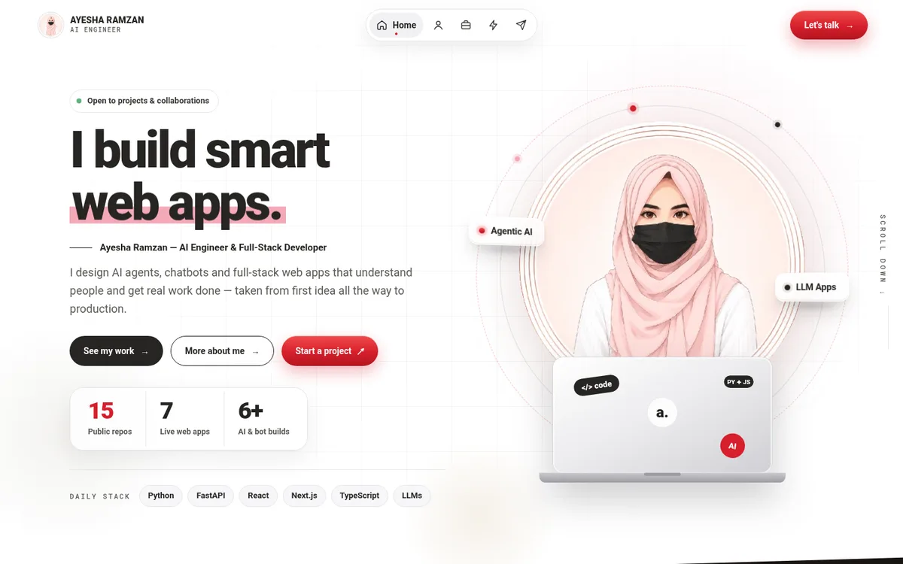

# Ayesha Ramzan — Portfolio

Personal portfolio of **Ayesha Ramzan**, AI Engineer & Full-Stack Developer.

**Live:** https://ayesha-ramzan.vercel.app · https://ayesha-ramzan.github.io/portfolio/



## Pages

- **Home** — hero, about, featured work, services, how I work, FAQ
- **About** — story, stats, toolkit and working principles
- **Work** — all projects, plus experiments from the lab
- **Services** — what I offer, project process and toolkit
- **Contact** — project form that opens a pre-filled email

## Built with

Plain HTML, CSS and JavaScript — no build step. GSAP powers the desktop scroll animations; phones get lightweight CSS animations instead. Deployed on Vercel and GitHub Pages.

- Responsive from 320px phones to wide desktops
- Accessible (Lighthouse accessibility 100), SEO 100, best practices 100
- Content-Security-Policy and Subresource Integrity on third-party scripts

## Run locally

```bash
git clone https://github.com/Ayesha-Ramzan/portfolio.git
cd portfolio
python3 -m http.server 5500
```

Then open http://localhost:5500.

## Contact

[LinkedIn](https://www.linkedin.com/in/ayesha-ramzan-9632a83ba/) · [GitHub](https://github.com/Ayesha-Ramzan) · ayeshazubram@gmail.com
