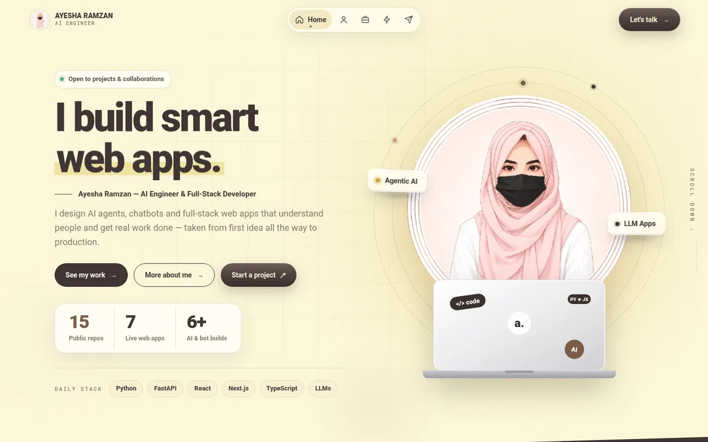

<div align="center">

# Ayesha Ramzan — Portfolio

**AI Engineer & Full-Stack Developer** · Agentic AI · LLM apps · Web apps

[](https://ayesha-ramzan.vercel.app)
[](https://ayesha-ramzan.github.io/portfolio/)


<br>

<a href="https://ayesha-ramzan.vercel.app"></a>

</div>

---

## Highlights

- **Multi-page site** — Home, About, Work, Services and Contact, each with its own page and a dock-style navigation bar
- **Motion with purpose** — intro loader, rotating headline, orbit rings around the portrait, blur-to-sharp headings and smooth scroll reveals
- **Custom cursor** — arrow cursor with a dot trail that appears only while the mouse moves
- **Fast on phones** — GSAP loads on desktop only; phones get lightweight CSS animations instead
- **Fully responsive** — tested from 320 px phones to wide desktop screens, with no horizontal scroll
- **Secure by default** — Content-Security-Policy, Subresource Integrity on third-party scripts, HTTPS everywhere, no stored user data

## Pages

| Page | What's on it |
|---|---|
| **Home** | Hero, about card, featured work, services, how I work, FAQ, call to action |
| **About** | My story, stats, toolkit and the principles I work by |
| **Work** | All projects — company work, client-style builds and AI experiments |
| **Services** | Agentic AI, AI engineering, full-stack, frontend and Python backend, plus the project process |
| **Contact** | Project form that opens a pre-filled email — nothing is stored on the site |

## Project structure

```
portfolio/
├── index.html        # Home
├── about.html        # About
├── work.html         # Work
├── services.html     # Services
├── contact.html      # Contact
├── styles.css        # Shared design system and page styles
├── site.js           # Shared behaviour for inner pages (cursor, reveals, form)
└── assets/           # Optimised images (WebP) and short MP4 previews
```

## Run locally

No build step — it's plain HTML, CSS and JavaScript.

```bash
git clone https://github.com/Ayesha-Ramzan/portfolio.git
cd portfolio
python3 -m http.server 5500
```

Then open **http://localhost:5500**.

## Deployment

- **Vercel** — production at [ayesha-ramzan.vercel.app](https://ayesha-ramzan.vercel.app)
- **GitHub Pages** — mirror at [ayesha-ramzan.github.io/portfolio](https://ayesha-ramzan.github.io/portfolio/), updated on every push to `main`

## Contact

[Portfolio](https://ayesha-ramzan.vercel.app) · [LinkedIn](https://www.linkedin.com/in/ayesha-ramzan-9632a83ba/) · [GitHub](https://github.com/Ayesha-Ramzan) · [Instagram](https://www.instagram.com/ayesh_ramzan786/) · [X](https://x.com/ayesha5044) · ayeshazubram@gmail.com

<div align="center"><sub>Designed & built by Ayesha Ramzan</sub></div>
